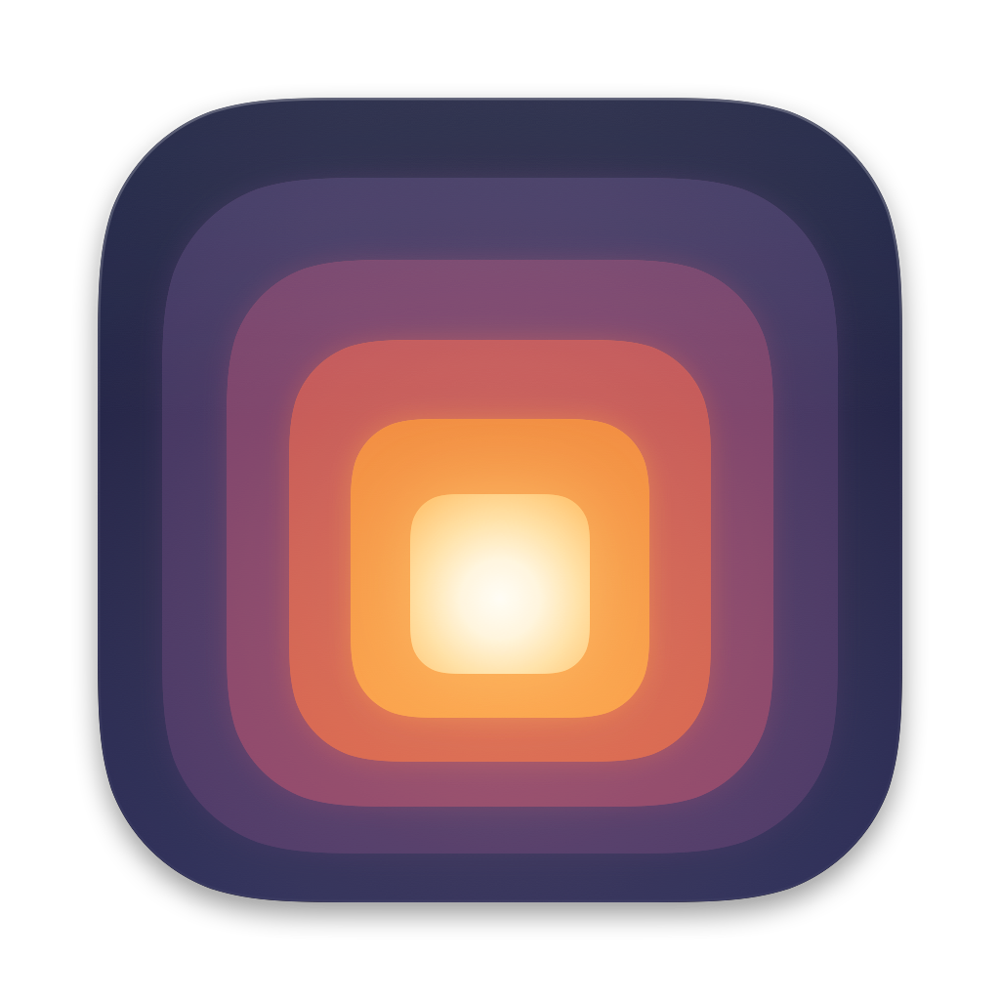

<p align="center">
  
</p>

<h1 align="center">
  <picture>
    <source media="(prefers-color-scheme: dark)" srcset="assets/wordmark-on-dark.svg">
    
  </picture>
</h1>

<p align="center">
  <strong>A blue light filter for your Mac: warms and dims the screen from sunset to bedtime,<br>
  so evenings are easier on your eyes.</strong><br>
  Free and open source · no account · no tracking
</p>

<p align="center">
  
</p>

## Install

1. Download **Gloam.dmg** from [Releases](https://github.com/Que-tin/gloam/releases/latest), open it and
   drag Gloam into Applications.
2. Open Gloam. macOS blocks the first launch because Gloam isn't notarized (that needs a paid Apple
   developer account): open **System Settings › Privacy & Security** and click **Open Anyway**.

Needs macOS 14 or later, Apple silicon or Intel. Gloam updates itself (see below). To remove it,
run `/Applications/Gloam.app/Contents/MacOS/Gloam --uninstall`, then delete the app.

## What it does

- **Warms, then dims.** Warm colour alone cuts only about half the light that keeps you alert;
  dimming does the rest.
- **Follows the sun and your bedtime.** Warm from sunset, deepest an hour before bed (23:00 unless
  you change it), daylight again in the morning. Nothing to set up.
- **Dims the backlight itself** on Mac screens, Apple displays and DDC/CI monitors, like the
  brightness keys do. Other monitors are dimmed in software.
- **Shows the effect.** The lamp in its menu-bar popover estimates how much blue light still
  reaches you.
- **Pauses** for an hour, until morning, or while an app like Lightroom is in front.

Settings shows your evening as a graph: drag bedtime, wake and how warm and dim the night gets.

<details>
  <summary>Welcome and Settings</summary>
  <p align="center">
    
    
  </p>
</details>

## How it compares

|  | Gloam | f.lux | Night Shift |
|---|---|---|---|
| Warms the screen on a schedule | ✓ | ✓ | ✓ |
| Dims as part of the schedule | ✓ | – (dim by hand) | – |
| Follows the sun | ✓ | ✓ | ✓ |
| Deepens toward bedtime | ✓ | ✓ (from wake time) | – |
| Shows how much blue light reaches you | ✓ | – | – |
| Scripting | URL scheme | – | Shortcuts |
| Dims external monitors in hardware (DDC/CI) | ✓ | – | – |
| Open source | ✓ (MIT) | – | – |

## Good to know

- **One tinting app at a time.** Turn off any other app that tints the screen; two at once flicker.
- **Updates itself.** Gloam checks GitHub for new versions about once a day and installs them when
  you say so (switch it off in Settings, or use **Check for Updates…** in the right-click menu).
- **Private.** No tracking and no location permission: sunset comes from your time zone. The only
  network use is the update check and an optional city search, which sends the name to Apple Maps.
- **Shortcuts, Spotlight and Focus:** "Set Gloam" and "Pause Gloam" actions in Shortcuts, and a Focus
  filter that pauses Gloam while a Focus is on (System Settings › Focus; a Focus with it starts
  Gloam if it isn't running). A keyboard shortcut to
  turn it on or off can be set in Settings, and `open gloam://toggle` (or `on`, `off`, `open`) works too.
- **Not medical.** Gloam reduces evening melanopic light (CIE S 026); it doesn't claim to improve
  sleep. The research behind every default: [docs/science.md](docs/science.md).

**Known issues:** hardware dimming of external monitors is verified on one monitor so far (hubs,
docks and DisplayLink fall back to software). Gloam uses private macOS interfaces that an update
can break; it then falls back to software dimming. Intel Macs and macOS 14–15 aren't tested on
hardware yet.

## Build from source

Needs Xcode 27. See [CONTRIBUTING.md](CONTRIBUTING.md).

```sh
git clone https://github.com/Que-tin/gloam && cd gloam
./scripts/build-app.sh && open .build/Gloam.app
```

## License

[MIT](LICENSE). The license covers the code; the Gloam name, icon and wordmark are not part of it:
forks are welcome, but please give yours its own name and icon.
