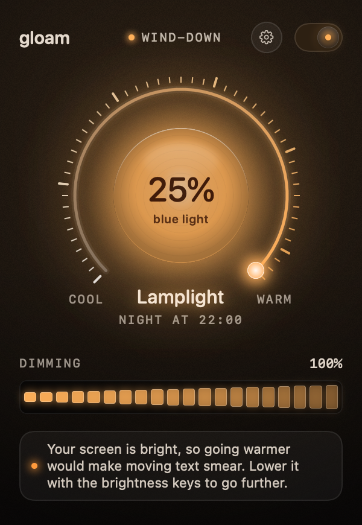
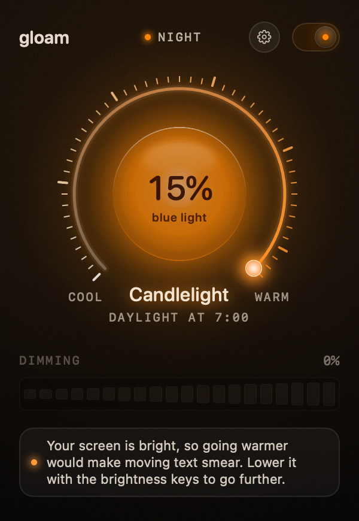
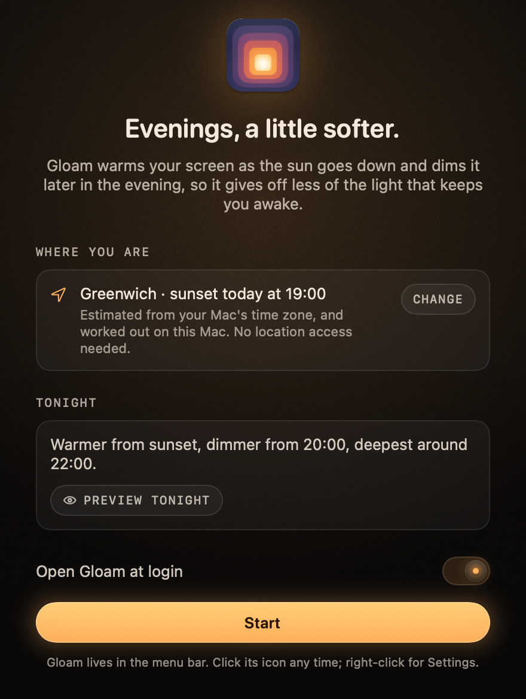
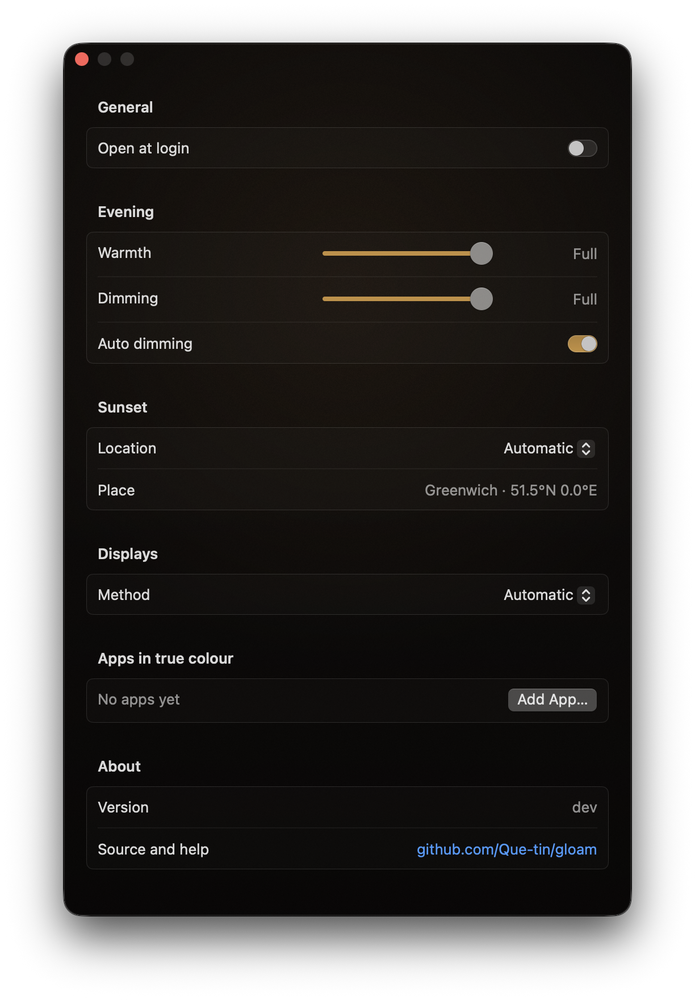

<p align="center">
  
</p>

<h1 align="center">Gloam</h1>

<p align="center">
  <strong>A warm lamp for your Mac's evenings: it warms the screen from sunset and dims it before bed, timed to the sun.</strong><br>
  Free and open source · no account · no tracking · native Swift
</p>

<p align="center">
  
  
</p>

<details>
  <summary>Welcome and Settings</summary>
  <p align="center">
    
    
  </p>
</details>

---

Gloam sits in your menu bar and turns your screen into something closer to lamplight in the
hours before bed, then brings full daylight back when you wake. It's built
around what sleep research says matters:

- **It dims as well as warms.** Warm colour on its own cuts only about half of the light that keeps
  you alert; lowering brightness does most of the work. Gloam does both.
- **It follows the sun, then winds you down.** It warms as the sun goes down, dims later in the
  evening (only once the sun is setting), goes deepest an hour before bed, and is back to
  daylight in the morning. Nothing to set up: the evening is timed from a 23:00 bedtime that
  suits most people; limits in Settings keep it from getting warmer or darker than you like.
- **It shows you the effect.** The lamp in the popover glows with your screen's current colour and
  estimates how much blue light still reaches you, compared with the same screen untinted at
  the brightness you set. On the built-in screen, Apple displays and monitors that support
  DDC/CI it dims the backlight itself, the way the brightness keys do (never below about
  40 cd/m²); other monitors are dimmed in software, never below 30%, so shadows stay readable.

Room lighting and total screen time matter more than any screen app. Gloam helps with the part a
screen can.

## Using it

- **The lamp.** It glows with your screen's colour right now and shows how much blue light still
  reaches you. Its dial and ladder show the live warmth and dimming, each from none to as far as
  your screen goes; move them (or scroll, or use the arrow keys) to take over by hand until the
  next change, and "Auto" hands back at once. The switch at the top turns Gloam off and on.
- **True colour where it matters.** Add apps such as Lightroom, Photoshop or a video player as
  exceptions (from the gear menu while you're using one, or in Settings) and Gloam steps aside
  while they're in front. To stop Gloam for a while, use the switch.
- **Too warm or too dark?** Warmth and Dimming (in Welcome's preview and in Settings)
  cap the evening; automatic runs as designed until it would cross a cap. Auto dimming eases the
  dimming in a bright room (MacBook, lid open).
- **Settings** (gear, or right-click the menu-bar icon) also hold your location, which screens
  to tint, app exceptions and launch at login.

Everything works from the keyboard and with VoiceOver.

## Install

Download `Gloam.app` from [Releases](https://github.com/Que-tin/gloam/releases) and move it to
Applications. Builds aren't notarized yet, so macOS blocks the first launch: open **System
Settings › Privacy & Security**, scroll down and click **Open Anyway**. (On macOS 14 you can
right-click Gloam.app and choose **Open** instead.)

Or build it yourself (needs Xcode 26):

```sh
git clone https://github.com/Que-tin/gloam && cd gloam
./scripts/build-app.sh && open .build/Gloam.app
```

Requires macOS 14 or later, on Apple silicon or Intel.

To remove it completely, run `Gloam.app/Contents/MacOS/Gloam --uninstall` (clears its login item
and settings), then move the app to the Bin.

If another app (or macOS itself) also tints your screen in the evening, turn
that off. Two apps tinting the screen at
once make it flicker; Gloam tells you if something keeps changing the screen's colours.

## How it compares

|  | Gloam | f.lux | Night Shift |
|---|---|---|---|
| Warms the screen on a schedule | ✓ | ✓ | ✓ |
| Dims as part of the schedule | ✓ | – (dim by hand) | – |
| Follows the sun | ✓ | ✓ | ✓ |
| Deepens toward bedtime | ✓ | ✓ (from wake time) | – |
| Shows how much blue light reaches you | ✓ | – | – |
| Command line / scripting | URL scheme | – | – |
| Dims external monitors in hardware (DDC/CI) | ✓ | – | – |
| Open source | ✓ (MIT) | – | – |

## Under the hood

- **Colour accuracy.** Colours come from the physics of warm light, so 1900 K looks like a candle
  rather than a filter. Gloam also keeps your monitor's colour calibration.
- **Real tinting.** Gloam changes the colour signal itself, so blue is actually removed and blacks
  stay black. On the few Macs where macOS ignores that (M5 Pro and M5 Max MacBook Pros, and the
  MacBook Neo on external displays), it uses a screen overlay instead. You can choose the method
  in Settings.
- **No location permission.** Sunset is worked out from your time zone on the Mac, or from a city
  you pick.
- **Scriptable** with Shortcuts, Raycast, Alfred, cron or a shell:

  ```sh
  open gloam://toggle   # or gloam://on, gloam://off, gloam://open
  ```

The research behind every default, with sources: **[docs/science.md](docs/science.md)**.

## Privacy

Gloam makes no network requests, with one exception: if you search for a city in Settings, the
name is sent to Apple Maps. Settings stay in your Mac's user defaults.

## Health note

Gloam reduces the evening screen light that most affects your body clock (melanopic light, per
CIE S 026), following the 2022 expert recommendations. It is not a medical device and makes no
claim to improve sleep or treat any condition.

## Contributing

See [CONTRIBUTING.md](CONTRIBUTING.md). Bug reports from unusual display setups are especially
welcome.

## License

[MIT](LICENSE)
